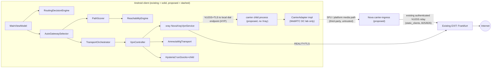

# Nova VPN: VK Calls / MAX carriers, Reachability Fabric, gateway management. Architecture report (READ-ONLY research)

## Context

The owner asked for a read-only, evidence-based investigation and a target architecture covering VK Calls/MAX as optional carriers, a transport-independent SecureSession, CarrierAdapter/CarrierSupervisor, the Reachability Fabric, and gateway lifecycle management. Nothing was edited, committed, pushed or deployed. No gateway, VK or MAX endpoint was contacted. Reference repos were shallow-cloned into the session scratchpad and read as data; none of their code was run.

This report was drafted under plan-mode rules and copied here after approval; a docs-only PR needs separate owner approval.

**Process note (said once):** No Agent/Task tool exists here, so the `vpn-architecture` review discipline was applied directly in this session (CLAUDE.md rule 7).

Evidence labels: **[V]** verified in source or git, **[H]** historical (ROADMAP or memory, not re-measured), **[I]** inference, **[R]** recommendation, **[Q]** open question, **[UNVERIFIED]** could not be checked, **[EXT]** external claim (README, docs or general knowledge, not verified against this repository), **[HYP]** design hypothesis, not implemented or tested.

**Revision note (2026-10-18, post-audit):** An independent read-only audit found 2 Critical, 4 High, 8 Medium and 6 Low issues in the first version. This version corrects them. The biggest changes:
- The carrier end-to-end proof (§D.4/§G): the existing `HttpRelayEndToEndProbe` is out-of-band and cannot prove the tunnel.
- The Android process/TUN design (§D.3/§E): `:xray` owns the TUN; there is no tun2socks on the Xray path.
- Carrier stream semantics (§D.1a).
- SecureSession authentication (§D.5/§I D2).
- The revocation and ingress trust model (§D.7/§F).

Wherever a statement is still unproven, it is labelled **[HYP]**, **[EXT]** or "test required".

---

## A. Executive summary

**Repository state [V].** Root is `C:/Users/akaza/Downloads/VPN`. HEAD is detached at `0c46261` (= `origin/main`, merge of PR #180). The working tree was clean at research time; the only change since is this untracked report. Remote: `kazakovak2001-lgtm/VPNrus`. There are 26 additional worktrees (27 in total). Seven of them have uncommitted changes that this report did not inspect:
- `VPN-B45B-NATIVE-PACKAGING` (4)
- `VPN-B46-4A` (8)
- `VPN-b54-d79db32` (6)
- `VPN-b57-force-relayed` (6)
- `VPN-independent-egress-test` (2)
- `VPN-p2-baseline` (2)
- `VPN-p2-field` (1)

Nothing in any worktree was modified. The most relevant worktrees:
- `VPN-B46-4A` (Hysteria2 production)
- `VPN-B45B-NATIVE-PACKAGING` (Shadowsocks)
- `VPN-b49`, `VPN-b50`, `VPN-b52` (chaos, ASN survivability, outage)
- `VPN-BETA-CUT`
- `VPN-egress-probe-integration`

The only open PR is #60, a draft (B36 bootstrap pre-activation tunnel, from 2026-09-05).

**What exists today:**
- A mature multi-transport Android client. Each transport owns its own `VpnService`/TUN:
  - AWG 3.1 and Xray REALITY/TLS are IMPLEMENTED and E2E-verified.
  - XHTTP: the code supports the CDN relay and AWG → Direct-EXIT failover (B66.18, `smartconnect/AwgXrayFailoverPolicy.kt`). The current signed manifest offers only the CDN relay (ROADMAP L454). Verified on unrestricted networks only.
  - Hysteria2 + Salamander exists in debug/field-test builds only, Stockholm only, with legal review G1 open.
  - Shadowsocks-2022 is FOUNDATION and fail-closed.
- A signed Ed25519 manifest with last-known-good (LKG), an embedded bootstrap and rollback protection (IMPLEMENTED).
- AutoGatewaySelector, which ranks gateway × transport through the ReachabilityEngine → PathCandidateBuilder → PathScorer chain (IMPLEMENTED for Auto mode).
- RoutingDecisionEngine as the DIRECT-vs-VPN authority (IMPLEMENTED).
- An ingress→exit relay with an end-to-end proof gate that is Xray-native today (B33); a carrier needs its own in-tunnel confirmation (§D.4).
- B-WL7 post-connect data-plane gates for AWG and Direct Xray.
- Typed diagnostics (B29/B30/B37).

**What is partial:**
- Smart Connect link-quality scoring (no RTT/loss/jitter tier in `PathScorer`).
- Auto coverage of XHTTP-direct and Hysteria2.
- Path re-evaluation after a network change.
- Per-transport leak matrix.
- Independent control-plane origin (does not exist).
- Durable gateway pool: the Stockholm IP is not reserved.
- Server provisioning is bespoke scripts per role, with no node registry or lifecycle state machine.

**What is missing entirely [V]:**
- No WebRTC, VK, MAX, TURN or SFU code anywhere in the repo (`git grep` hits only unrelated gateway test strings).
- No transport-independent SecureSession.
- No CarrierAdapter abstraction separate from `VpnTransport`.
- No node inventory or lifecycle state machine.
- No Android unit tests in CI. `.github/workflows/` has only `gateway-tests.yml`.

**Field reality [H] (ROADMAP §Current verification status, one RU home Wi-Fi, 2026-10-07/08):**
- Working: REALITY Stockholm:2053 and the REALITY relay to Frankfurt.
- Intermittent: AWG.
- Dead: every `*.pp.ua` SNI, TLS_TCP:2083, and pre-Salamander Hysteria2.
- Not measured: cellular and hard-whitelist networks.

**Main technical risks:**
1. Every surveyed VK/MAX approach depends on reverse-engineered private APIs, real phone-number accounts, and some degree of client impersonation. That conflicts with ROADMAP architecture principle 4 and with this brief's "do not impersonate VK/MAX".
2. Carrier throughput is low or unknown. The only figure is anazoa's unverified ~2 Mbps claim.
3. A carrier tunnel is a new Go/Rust runtime. Under the one-Go-runtime-per-process invariant, it would need its own process.
4. The VK/MAX work competes with unfinished P0 gates: non-pp.ua domain, B54 cellular, data-plane proof, independent control origin.

**Recommended architecture [R]:**
- Do **not** build a second tunnel stack. Model VK/MAX as **carriers behind the existing ingress/relay model**: the carrier replaces only the client→ingress hop.
- Keep `:xray` as the only TUN owner on this path. The carrier runs in a separate child process that provides a local dial endpoint. Whether the pinned Xray can dial such an endpoint safely is **[HYP], test required** (§D.3).
- Reuse VLESS over TLS 1.3, or WireGuard/AWG, as the **SecureSession**. Do not design new crypto.
- Admit the result through `RelayReadinessStage.END_TO_END_DATA_PLANE_OK`, but only via a carrier-native in-tunnel confirmation that is still to be built. The existing out-of-band `HttpRelayEndToEndProbe` cannot prove the tunnel (§D.4).
- Keep VK/MAX at **RESEARCH / isolated lab** until the owner and legal review decide the impersonation/ToS question. It must not displace P0 gates 1–6.
- For gateway management: **reject** Remnawave/Hiddify adoption. Build a small Nova node registry and lifecycle state machine on top of the existing `gateway/api` + `gateway/scripts` + signed manifest pipeline.

---

## B. Evidence-based repository inventory

| Component | Status | Evidence (path @ `0c46261`) | Test evidence | Gaps | Confidence |
|---|---|---|---|---|---|
| VpnService/TUN data plane | IMPLEMENTED, per transport | `vpn/AmneziaWgTransport.kt`, `vpn/xray/NovaXrayVpnService.kt` (`:xray` process), `vpn/hysteria/Hysteria2VpnService.kt`, `vpn/shadowsocks/ShadowsocksVpnService.kt`. Each transport owns its TUN. | Unit + physical (ROADMAP B10-1, B13–B16) | No shared TUN owner. IPv6 is fail-closed everywhere (`supportsIpv6=false` in every `TransportCapabilities` factory). | High |
| Transport contract | IMPLEMENTED | `vpn/VpnTransport.kt` (connect/disconnect/observeState/probe/stats/dataPlaneCounters/probeIndependentEgress), `transport/TransportCapabilities.kt` (11 booleans + maturity), `vpn/TransportState.kt` | Unit | Whole-tunnel abstraction: there is no frame-level carrier interface. | High |
| TransportKind | IMPLEMENTED | `transport/TransportKind.kt`: AMNEZIA_WG, XRAY_REALITY, QUIC, TLS_TCP, XRAY_XHTTP, SHADOWSOCKS_2022, HYSTERIA2. Ordinal-serialized in the signed manifest; append-only. | `TransportKindOrdinalCompatibilityTest` | Any new carrier kind must be appended. Unknown kinds are kept opaque (forward-compat fix, ROADMAP L259). | High |
| Orchestration | IMPLEMENTED | `transport/TransportOrchestrator.kt`, `TransportRegistry.kt`, `vpn/VpnController.kt` | Unit, MainViewModel tests | n/a | High |
| Routing authority | IMPLEMENTED | `smartconnect/RoutingDecisionEngine.kt`, `vpn/policy/*` | `RoutingDecisionEngineTest`, physical (ROADMAP L224) | IPv6 is fail-closed only | High |
| Smart Connect (Manual mode) | FOUNDATION | `smartconnect/SmartConnectDecisionEngine.kt`: fixed `PREFERRED_ORDER`, health parameter unused (ROADMAP L220) | Unit | No link quality | High |
| Auto gateway selection | IMPLEMENTED | `smartconnect/AutoGatewaySelector.kt`, `reachability/PathScorer.kt`, `PathCandidate.kt`, `EndpointReachability.kt` | Unit + physical B16/B19 | Direct candidates are AWG/REALITY/TLS/SS only. Excludes XHTTP-direct and Hysteria2 (ROADMAP L220). | High |
| Restriction/whitelist detection | FOUNDATION | `RestrictionClassifier.kt`, `RestrictionStabilizer.kt`, `DiverseReachabilityEvaluator.kt`, `TransportBehaviorEvidence.kt` | Unit | No field validation of `POSSIBLE_HARD_WHITELIST` | Med |
| Data-plane gate | PARTIAL | `smartconnect/TrafficProgressMonitor.kt`; B33 `/v1/tunnel-probe`; `Hysteria2TunnelProbe.kt`; `vpn/xray/IndependentEgressProbe.kt` | Unit; device runs [H] | No transport satisfies all 4 layers (ROADMAP L460). Hysteria2 has no post-connect gate. | High |
| Relay / ingress | FOUNDATION → deployed Stockholm→Frankfurt | `relay/*`, `gateway/api/ingress_activation.py`, `xray_ingress_config_renderer.py`, `relay_probe_token.py` | Unit + physical relay [H] | Relay is not whitelist-validated | Med |
| Signed manifest / bootstrap | IMPLEMENTED | `reachability/EndpointManifest*.kt`, `ManifestVerifier.kt`, `EmbeddedBootstrapManifest.kt`, `gateway/tools/manifest_signing.py` | Unit + physical B17 | v8 prepared but unsigned [H] | High |
| Control plane | IMPLEMENTED, single origin per gateway | `gateway/api/handler.py`, `activations.py`, `controlplane/*` (B30 executor) | Gateway pytest in CI | No independent second origin. `*.pp.ua` filtered in RU [H]. | High |
| Provisioning (server) | IMPLEMENTED, bespoke | `gateway/provision.sh`, `gateway/scripts/install-ingress-role.sh`, `deploy-backend-update.sh`, `gateway/systemd/*`, `gateway/nftables/*` | pytest for templates (`test_edge_deployment_config.py`) | No node registry, no lifecycle states, no IaC. Env drift happened twice (ROADMAP L229). | High |
| Identity | IMPLEMENTED (managed AWG binding merged in #180) | `identity/*`, `a23b4e8` | JVM unit only | **ROADMAP L279 is stale**: it says "not yet pushed/merged", but PR #180 was merged into `main` as `0c46261` on 2026-10-18. | High |
| Diagnostics | FOUNDATION | `diagnostics/*` (B29 recorder, sanitizer), `DiagnosticFailureReason` | Unit | No support backend (B63) | High |
| Leak protection | PARTIAL | `vpn/config/VpnLeakProtectionPolicy.kt`, `AlwaysOnVpnState.kt` | B10-1 manual [H] | Process death without Lockdown fails open (security debt, ROADMAP L475). Clone-app UIDs are not coverable. | High |
| Hysteria2 SOCKS5 fix | IMPLEMENTED, E2E-VERIFIED, debug only | `vpn/hysteria/Hysteria2LocalSocks.kt`: per-session creds, ephemeral loopback port (ROADMAP L476) | Unit + OPPO device [H] | DNS transport not isolated | High |
| VK/MAX / WebRTC carrier | **ABSENT** | `git grep -il webrtc\|pion\|vkcalls\|maxcalls` → no Android/gateway source hits | none | Everything | High |
| CI | PARTIAL | `.github/workflows/gateway-tests.yml` only | n/a | Android unit suite not in CI | High |

---

## C. Reference-project comparison

All repos were inspected at the HEADs below via shallow clone, source read only.

**Evidence level per row.** Only these specific findings are **source-read**:
- whitelist-bypass key derivation (`relay/tunnel/obfuscator.go:78-84`)
- olcrtc HKDF (`internal/crypto/chacha.go:171-179`)
- anazoa integrity token (`auth/src/integrity.rs`) and `deviceType`/`appVersion` (`auth/src/oneme.rs:393-394`)
- swinter prebuilt `app/libs/Vpnlib.aar` and `MaxAuthService.kt`
- vk-calls-tun missing LICENSE file
- maxcalls LICENSE text

Everything else is **README-claim [EXT]** or **inference [I]**:
- the transport modes (DataChannel/VP8/H.264/VP9/TURN)
- the "carries TCP/UDP" claims
- olcrtc UDP support (inferred from file presence)
- the Remnawave/Hiddify feature lists
- Nielkro being the successor of Nielk

No reference project was run, and none is shown here to carry traffic on any RU network. The evidence ladder is: feasibility evidence ≠ working prototype ≠ secure production implementation ≠ legal/ToS acceptability. Every row below is at most feasibility evidence. Licences were read from LICENSE files or GitHub metadata and have not been legally reviewed.

| Project @ SHA | Architecture (see evidence note above) | Carries arbitrary IP? | Dependencies | Licence | Risks | Recommendation |
|---|---|---|---|---|---|---|
| kulikov0/whitelist-bypass @ `820a631` (Go, active 2026-10-12) | Android VpnService → tun2socks → SOCKS5 → headless Pion joiner. Carried over SFU DataChannel ("DC") or VP8 video track. Remote "creator" runs a relay bridge to the Internet. Backends: VK, Telemost, WB Stream (LiveKit). | TCP/UDP via tun2socks + SOCKS5 (not raw IP packets) | Pion WebRTC, tun2socks, gomobile | MIT | "Obfuscator" is XChaCha20-Poly1305 with key = SHA256(shared secret) (`relay/tunnel/obfuscator.go:78-84`): a single PSK with no PFS and no peer identity. Uses VK HTTP call API (`headless/vk/main.go`) on reverse-engineered endpoints. Requires a call creator account. | **Isolated experiment only.** Design reference for SFU DataChannel feasibility. No code reuse into Nova. |
| ghostlane-project/olcrtc @ `173e533` (fork of openlibrecommunity/olcrtc, branch `proofkit`) | `app → SOCKS5 → olcrtc cnc → SFU → olcrtc srv → internet`. smux over DataChannel/VP8/"videochannel". Engines for jitsi, livekit, mtslink, salutejazz, vkcalls, goolom. KCP for the VP8 channel. | TCP proxy (SOCKS5), plus UDP flow support (`internal/client/udp.go`) | Pion, smux, KCP | Apache-2.0 | Per-role keys via HKDF from a PSK (`internal/crypto/chacha.go:171-179`): PSK-only, no PFS. "Beta". Relies on multiple third-party SFUs' private signalling. | **Best-engineered reference.** Isolated experiment candidate for a *lab* DataChannel carrier. Apache-2.0 is compatible but still needs NOTICE review. No direct reuse before security review. |
| ghostlane-project/ghostlane @ `38e33e5` (KMP client) | Client app: olcRTC plus Reality/Hysteria2/XHTTP; hev-socks5-tunnel (lwIP) as TUN→SOCKS bridge | via olcRTC | olcRTC, hev-socks5-tunnel | MIT (bundled components carry their own licences) | Shipped on Play/App Store [UNVERIFIED as compliance precedent] | Reference for multi-carrier UX only |
| mipselqq/vk-calls-tun @ `110d229` (last push 2026-04-02) | IP packets embedded in a synthetic H.264 track over the VK call (ICE/DTLS/SRTP). Receiver/caller roles join by invite link. Includes an anonymous OAuth chain (`internal/vkauth`). App-layer redundancy for loss. | Yes, IP-in-video (TUN) | Pion, H.264 encoder | **None (no LICENSE file)**: all rights reserved | No licence. Author admits loss is "a lottery". Uses VK anonymous auth. | **Reject for reuse** (licence). Cite only as evidence that a media-bitstream carrier exists. |
| Nielk/proxy-turn-vk-android | **404**. Probable successor `Nielkro/proxy-turn-vk-android` ("qWDTT") [I]: WireGuard over VK TURN relay with WRAP/RTP framing. VK account auth by intercepting TURN creds from a WebView. Compatible with `amurcanov/proxy-turn-vk-android` (WDTT). | WireGuard (UDP) via TURN | wdtt-server | GPL-3.0 | Harvests VK TURN credentials; TURN relay abuse to arbitrary peers (VK can close this by restricting relay peers). GPL-3.0. | **Reject** for reuse. TURN-abuse model documented as a risk case. |
| anazoa/anazoa @ `09995e4` (Rust) | P2P IP over MAX WebRTC video: tunnel frames embedded in the VP9 bitstream, paced by libwebrtc. **"Both ends impersonate an Android Max client"** (README). `auth/src/integrity.rs` reproduces MAX's START_AUTH integrity token from hashes of the official APK's signer cert, libs and dex (reverse-engineered from `libmax.so`, `MAX_APP_VERSION 26.30.1`). Needs two phone numbers. Answer gating mitigates active probing. | Yes, TUN P2P | libwebrtc (patched), Rust | Apache-2.0 | **Direct client impersonation and attestation forgery.** Breaks with every MAX app update. Account bans. ~2 Mbps is the author's claim [UNVERIFIED]. | **Reject.** Violates ROADMAP principle 4 and this brief. The answer-gating idea is worth noting. |
| somewhat-industries/swinter-android @ `713496d` / swinter-ios | WG/AWG over DTLS over **MAX TURN relays**. Logs into MAX (SMS, `deviceType=ANDROID` impersonation, `MaxAuthService.kt`). Starts a call (opcode 78) to a target user to capture TURN creds, then hangs up ("phantom ring"). Android ships a **prebuilt `app/libs/Vpnlib.aar`** plus a sources jar. | WG UDP via TURN | pion/turn, pion/dtls, prebuilt AAR | Unlicense | Third-party user disturbance, TURN abuse, client impersonation, unverifiable binary blob, inactive since 2026-04 | **Reject.** |
| icyfalc0n/maxcalls @ `cdcba2d` | Reverse-engineered MAX call API library (OneMe WS auth, calls HTTP, signalling WS, ICE). Not a VPN. | No | Go | GPL-3.0 (LICENSE text; GitHub API "NOASSERTION"; not legally reviewed) | Private API, GPL | **Reject for reuse.** Docs are useful only to understand the MAX attack/ToS surface. |
| Remnawave (backend/node, docs.rw) | Panel + node manager around Xray-core (node component runs Xray). User/subscription management. | n/a | NestJS/TypeScript | **AGPL-3.0** | Xray-only [I from README/docs; node source not audited]. No AWG/Hysteria2 Nova model. AGPL network-use obligations. Second identity/entitlement system competing with `activations.py`. | **Reject adoption.** At most read its node-registration API design. |
| Hiddify-Manager (Python, active) | Single-server multi-protocol panel (Xray + sing-box; Reality, Hysteria2, TUIC, WireGuard, SSH, Telegram proxy) | n/a | Large stack | **GPL-3.0** | Opinionated full-host takeover. Conflicts with pinned bespoke provisioning, nftables, exit ACL. Own user model. | **Reject.** |

**Cross-cutting findings [V/I]:**
1. Every surveyed VK/MAX approach falls into one of three classes:
   - (a) SFU DataChannel/media via the platform's own call signalling (whitelist-bypass, olcrtc, vk-calls-tun).
   - (b) TURN relay credential harvesting (swinter, WDTT/qWDTT).
   - (c) full client impersonation including integrity-token forgery (anazoa).
   All three need a real account on the platform and reverse-engineered APIs. (b) and (c) are strictly incompatible with principle 4.
2. whitelist-bypass and olcrtc use PSK-derived AEAD without forward secrecy (source-read). The TURN projects (swinter, WDTT/qWDTT) tunnel WireGuard/AWG, whose own handshake provides mutual authentication and forward secrecy [EXT]. Those projects are rejected for ToS and impersonation reasons, not for their crypto.
3. Most implementations are SOCKS/tun2socks TCP+UDP proxies, not raw IP tunnels.

---

## D. Target architecture

### D.1 Core decision [R]

**A carrier is a new client→ingress hop, not a new VPN.** The existing relay model already separates `PathCandidate.Relayed.transport` (client↔ingress) from `exitTransport` (ingress↔exit), with an end-to-end proof gate that is Xray-native today (B33); a carrier needs its own in-tunnel confirmation (§D.4). A VK/MAX carrier terminates at a **Nova carrier-ingress** host, which forwards into the existing exit over the existing authenticated VLESS relay.

The **SecureSession is not new crypto**. It is an existing authenticated protocol (VLESS over TLS 1.3 via Xray, or WireGuard/AWG) run *inside* the carrier's byte/datagram stream. An ordered byte stream alone is **not** sufficient; see §D.1a.

### D.1a Carrier stream semantics [I/HYP, to be measured in C1]

- **Multiplexing.** Xray opens one TCP connection per proxied flow unless mux is configured. The carrier must therefore provide multiplexed streams: either one DataChannel per connection, smux (as olcrtc does [EXT]), or Xray mux. The choice is made by experiment C1. Each stream needs bounded per-stream buffers and backpressure.
- **REALITY adds nothing here.** REALITY's camouflage protects an exposed public port against active probing. In the SFU model the SFU terminates the outer DTLS/SCTP [EXT, unverified for VK/MAX], so the platform sees the inner TLS ClientHello directly. The inner protocol is therefore VLESS over TLS 1.3, which still gives confidentiality. REALITY gives no extra protection on this path.
- **Head-of-line blocking.** TCP carried over reliable, ordered SCTP stacks two congestion controllers with head-of-line blocking. DNS/UDP carried as VLESS-UDP over a reliable channel takes on TCP-like latency. Both must be measured.
- **Datagram alternative.** C1 must also measure a WireGuard/AWG datagram session over an unreliable/unordered DataChannel.
- **Framing.** Message framing must respect DataChannel message-size limits and path MTU.
- **Unresolved [Q].** Whether VK/MAX SFUs relay DataChannels between participants at all. The only evidence is README/source structure of whitelist-bypass and olcrtc [EXT].

### D.2 Component diagram



Note: the diagram simplifies the existing paths. Both Direct and relayed paths exist today, including the REALITY relay Stockholm → Frankfurt.

### D.3 Data flow (carrier path)

**Proposed flow [HYP]:**

`App packets → TUN owned by the existing :xray NovaXrayVpnService (unchanged) → Xray VLESS(+TLS) outbound → local dial endpoint served by a separate carrier child process (Go/Pion, its own process, no Xray) → WebRTC DataChannel(s) → platform SFU → carrier-ingress daemon → TCP to local Xray inbound → existing relay outbound → EXIT → Internet`

There is no tun2socks on this path.

Why this shape:
- The earlier draft (`:carrier` VpnService → tun2socks → SOCKS5 → Xray → carrier child) would need either a second Xray runtime next to a Go/Pion runtime in one process, or a second TUN owner.
- Two Go runtimes in one process is the crash class described in `PROJECT_ARCHITECTURE.md` §Process boundary and PR #154.
- A second TUN owner would duplicate `NovaXrayVpnService`.

The platform sees TLS-encrypted VLESS bytes plus full call metadata (§F).

**What is verified and what is not:**

| Statement | Status | Basis |
|---|---|---|
| The `:xray` core takes the TUN fd directly, with no tun2socks | **[V]** | `vpn/xray/XrayCoreController.kt` ~364-372, `coreRuntime.startLoop(ready.renderedConfig, fd)` |
| The Nova app is excluded from its own tunnel | **[V]** | `NovaXrayVpnService.kt:448`, `Hysteria2VpnService.kt:510`, `ShadowsocksVpnService.kt:334` (`addDisallowedApplication`) |
| Client Xray is pinned via wrapper `2dust/AndroidLibXrayLite` `c634d1b` (LGPL-3.0) | **[V]** | `third_party/xray/VERSION` |
| Nova renders any outbound with `dialerProxy`, a Unix socket or an abstract socket | **Not present [V]** | no match in `vpn/xray/*` or `third_party/xray` |
| The pinned core can dial VLESS(+TLS) to a Unix/abstract socket or via `sockopt.dialerProxy` | **[HYP/EXT]** | general Xray-core knowledge; not checked against this pinned build; **test required** |
| A loopback TCP dial endpoint can be protected from other apps on the device | **[HYP], open** | only precedent is SOCKS5 user/password between Nova's own children (`vpn/hysteria/Hysteria2LocalSocks.kt`); **design and test required** |
| The SFU relays DataChannels and carries arbitrary payload | **[EXT], unverified** | reference READMEs and source structure only |
| A carrier-native in-tunnel end-to-end proof exists | **Does not exist** | only the Xray-native B33 path and `Hysteria2TunnelProbe` exist today |
| How a carrier-child death maps onto `XrayProcessBridge` failure events | **[Q]** | design required |

### D.4 Connection / bootstrap sequence

```mermaid
sequenceDiagram
  participant C as Client
  participant M as Signed manifest (existing)
  participant CP as Control plane (existing /v1/ingress-profile)
  participant K as Carrier signalling (third-party)
  participant I as Carrier-ingress
  participant E as EXIT
  C->>M: verify Ed25519 manifest (LKG/embedded fallback)
  Note over C: carrier binding present only if signed + capability-gated (HYP: would follow the B35 CdnClientCapabilityPolicy pattern; does not exist)
  C->>CP: activate ingress profile (existing flow, endpoint-scoped)
  CP-->>C: VLESS creds + relay-health probe token
  C->>K: join rendezvous (lab: operator-owned room/account)
  K-->>I: peer joins, DataChannel opens
  C->>I: VLESS handshake inside DataChannel (SecureSession)
  I->>E: relay via static relay identity
  C->>I: in-tunnel confirmation through the carrier path (HYP: Xray-native measurement through the :xray core, B33 mechanism; the MainViewModel Xray-native branch is keyed on initialKind, so a new carrier TransportKind would not take it unless explicitly added - test required)
  Note over C: RelayProtected only after in-tunnel confirmation
  Note over C: HttpRelayEndToEndProbe = out-of-band diagnostic only (runs from the VPN-excluded app process, PROJECT_ARCHITECTURE B33 round 2)
```

**Why the end-to-end probe must change [V]:**
- `MainViewModel.kt` ~4674-4680 (`xrayNativeConfirmationAlreadyProvedDataPlane`) promotes `END_TO_END_DATA_PLANE_OK` without a further gate only for Xray kinds.
- Every other kind falls through to `relayEndToEndProbe.probe(...)` (~4734) as the gate. That probe runs from the excluded app process over the phone's normal network.
- So a new non-Xray carrier kind could reach `RelayProtected` while its own path is dead, whenever the exit host is directly reachable (for example on every Czech test network).
- A carrier must therefore have its own in-tunnel confirmation. It must not reuse that fallback.

### D.5 SecureSession lifecycle [R]

States: `NONE → CARRIER_UP → SESSION_HANDSHAKE → SESSION_ESTABLISHED → E2E_PROVEN (=Protected) → REKEY/EXPIRED → CLOSED`.
- AEAD, replay protection and the key schedule come from the reused protocol. Nova adds no cryptography.
- Authentication differs by protocol [I, protocol facts]:
  - **VLESS over TLS 1.3:** server authentication (certificate or REALITY key) and forward secrecy for session keys. Client authentication is a **bearer UUID** sent inside the channel. It is revocable but not mutual key-based.
  - **WireGuard/AWG (Noise IK):** mutual key-based authentication.
- Session binding: the per-device activation identity (VLESS UUID / WG key). The relay probe token (`gateway/api/relay_probe_token.py` `mint`, default TTL 300 s via `ingress_probe_ttl_seconds` in `gateway/api/ingress_config.py:148`) is an out-of-band diagnostic credential. It is **not** part of the session.
- `CARRIER_UP` alone never maps to Connected. The mapping goes through the existing `VpnSessionHealth.RelayHandshake` until `END_TO_END_DATA_PLANE_OK`.

### D.6 Carrier lifecycle

`IDLE → SIGNALLING → ICE_CHECKING → CHANNEL_OPEN → SESSION_ESTABLISHED → PROVEN → DEGRADED → FAILED/CLOSED`. Every transition has a bounded timeout. On FAILED, the result is handed to the existing `armFailoverWatch`/`attemptCombined` loop. No new failover authority.

### D.7 Gateway provisioning lifecycle

```mermaid
stateDiagram-v2
  [*] --> DISCOVERED
  DISCOVERED --> AUTHENTICATED: host key pinned + owner approval
  AUTHENTICATED --> PROVISIONING: OS/prereq preflight PASS
  PROVISIONING --> CONFIGURING: pinned artifacts installed + checksums
  CONFIGURING --> VALIDATING: firewall + transports + control plane up
  VALIDATING --> READY: data-plane/DNS/IPv4/IPv6/exit-ACL/failover tests PASS
  VALIDATING --> FAILED
  PROVISIONING --> FAILED
  CONFIGURING --> FAILED
  READY --> DEGRADED: health signals
  DEGRADED --> READY
  READY --> DRAINING: operator
  DEGRADED --> DRAINING
  DRAINING --> DECOMMISSIONED
  READY --> QUARANTINED: integrity/compromise signal
  QUARANTINED --> DECOMMISSIONED
  FAILED --> PROVISIONING: retry (idempotent; operator approval after N attempts)
  DISCOVERED --> REJECTED: owner declines / host key mismatch
  AUTHENTICATED --> FAILED
  VALIDATING --> QUARANTINED: integrity signal
  DEGRADED --> QUARANTINED: integrity signal
  READY --> CONFIGURING: any config or artifact-pin change
  DECOMMISSIONED --> [*]: credentials + relay identity revoked
  REJECTED --> [*]
```



Rules:
- Only `READY` nodes may appear in a newly signed manifest, as `ACTIVE`.
- Any change to config or artifact pins sends a node READY → CONFIGURING → VALIDATING again.
- DECOMMISSIONED requires revoking the node's credentials and relay identity.
- The automatic-retry threshold **N is undecided** (owner decision); no value is proposed here.

**Quarantine and revocation.** QUARANTINED triggers two actions:
1. A re-signed manifest marking the node `DISABLED` (existing `EndpointOperationalState { ACTIVE, DISABLED, RETIRED }`, `reachability/Endpoint.kt:51`).
2. Server-side revocation of the node's static relay identity on the exit (`gateway/tools/apply_relay_upstream_identity.py` revoke).

`DRAINING` maps to `DISABLED`.

Limitation [V/H]: clients that cannot refresh the manifest keep trusting their last-known-good or embedded manifest until it expires. The rollback guard only blocks downgrades; it does not push updates. Manifest delivery from RU is degraded today, because the `*.pp.ua` control-plane name is SNI-filtered on one RU Wi-Fi (ROADMAP L260/L473, historical). Quarantine therefore reaches clients only as fast as manifest delivery. The expiry of the current production manifests (v6/v7) was not decoded here [UNVERIFIED].

### D.8 Failure / failover state machine

This reuses the existing vocabulary (`DiagnosticFailureReason`, `VpnError`, `RelayFailureCategory`). New carrier reasons would extend those closed enums; no parallel enum. These are **proposed additions only; none exist in code**:
- `CARRIER_SIGNALLING_FAILED`
- `CARRIER_ICE_FAILED`
- `CARRIER_CHANNEL_CLOSED`
- `CARRIER_ACCOUNT_REJECTED`
- `CARRIER_RATE_LIMITED`

Mapping to the principle-3 classes:

| Class | Carrier cases |
|---|---|
| `NETWORK_UNAVAILABLE` | `NetworkProfile.isUsable` false |
| `GATEWAY_UNREACHABLE` | carrier ingress or EXIT unreachable |
| `PROTOCOL_BLOCKED` | ICE/channel failure with control reachable |
| `HARD_WHITELIST` | existing `POSSIBLE_HARD_WHITELIST` classifier |

Fail-closed (intended): carrier failures must not widen DIRECT routing. The existing `RoutingDecisionEngineTest` invariant covers restriction classes only, so a carrier-failure test is required. Process death without Always-on + Lockdown still fails open (ROADMAP L475).

### D.9 Trust boundaries

| Zone | Trust | Holds |
|---|---|---|
| Android app process | trusted | identity keys (AndroidKeyStore), manifest key |
| Carrier child process (proposed) | trusted code, isolated runtime | per-session creds only, never long-lived keys (same rule as `:xray`/Hysteria child) |
| VK/MAX platform (signalling, SFU, TURN) | **untrusted, adversarial, logging** | ciphertext, metadata, account identity |
| Carrier-ingress | semi-trusted (Nova-operated) | ingress creds, relay identity; never exit keys |
| EXIT | trusted | exit ACL (B47), entitlement enforcement |
| Control plane / signing | most trusted | activation store; signing key **offline** |

---

## E. Interface and data-model proposal (mapped onto existing types)

- **No new `CarrierAdapter` in the app process [R/HYP].** The app side is a relayed attempt whose client↔ingress transport is the existing Xray transport with a carrier dial target (§D.3). There is no second VpnService and no second TUN owner.
  - The carrier child is a new, isolated process. It is supervised the way `:xray` death handling works (bind + linkToDeath → typed Failed); the mapping onto `XrayProcessBridge` is still to be designed.
  - The frame-level contract (connect/close/send/receive, backpressure, cancellation) lives **inside the carrier child**, as a Go/Rust interface. This keeps the one-runtime-per-process invariant.
  - The Hysteria2 tun2socks pattern (`vpn/hysteria/*`) applies only if the inner protocol is **not** Xray.
- **New TransportKind required [R].** A carrier binding must use a new **appended** `TransportKind`, so older builds ignore the whole binding under the opaque forward-compat rule (ROADMAP L259). This exclusion has not been traced end to end here: **a test is required** showing that an opaque binding never reaches `PathCandidateBuilder` on an older build.
  - Do not rely on `IngressKind` alone. An unknown `ingressKind` string yields `null` (`reachability/Endpoint.kt:119-120`), and `PathCandidate.kt:96` falls back to `IngressKind.DIRECT_IP`.
- **Capabilities:** extend `TransportCapabilities` additively with:
  - `requiresThirdPartyAccount: Boolean`
  - `carriesViaThirdPartyRelay: Boolean`
  - `maxThroughputClass` (enum LOW/MED/HIGH)
  - `datagramCapable: Boolean`
  
  Today `PathScorer` reads only capability maturity and `restrictionPreference` (`reachability/PathScorer.kt:227`). These new fields would have **no effect** until an explicit, tier-bounded scorer change is made, with tier-dominance tests (principle 6). No per-protocol `if`.
- **Health/quality:** add the missing `PathScorer` link-quality tier (already planned, ROADMAP L220 item 1): RTT p50/p95, loss, jitter, reconnect success, `TrafficProgressMonitor` verdict. Carriers use the same tier; no carrier-specific scorer.
- **Manifest binding:** a carrier is an `EndpointTransportBinding` on an INGRESS endpoint, with `metadata`. This follows the B35 CDN profile pattern, so there are no new manifest binary fields. Metadata contents:
  - `carrierProvider` (opaque operator ID, never a hard-coded brand rule)
  - `rendezvousMode`
  - `minClientVersion`
  - `channelKind=DATACHANNEL_RELIABLE`
  
  Carrier secrets never go in the manifest.
- **Session metadata:** reuse `VpnAttemptContext.Relayed(plan)` + `historyPathId` (`ingressId:ingressKind:transport->exitId:exitTransport`). Optionally add `IngressKind.CARRIER_RELAYED` (append-only, `reachability/Endpoint.kt:48`), always together with the new TransportKind above.
- **Gateway registration record (server, new):** fields are `nodeId`, `provider`, `asn`, `region`, `roles` (EXIT/INGRESS/CARRIER_INGRESS), `hostKeyFingerprint`, `artifactPins` (from `gateway/xray/VERSION`, AWG pins, Hysteria pin), `state` (D.7), `lastValidationReportHash`, `approvedBy`, `auditLog[]`. Stored outside the signing host; feeds `manifest_signing.py` input.

---

## F. Threat model

| Threat | Mitigation | Residual |
|---|---|---|
| Malicious/compromised carrier platform (reads, drops, tampers, records) | SecureSession = VLESS over TLS 1.3 (AEAD, server-authenticated) inside the channel; carrier-native in-tunnel confirmation (to be built, §D.4) | Full metadata: who calls whom, when, volume, account ↔ phone ↔ real identity. MAX accounts require phone numbers [EXT]. If platform data is accessible to authorities [EXT, unverified], the exposure is severe for RU users. |
| Platform blocks/bans account or changes API | Carrier is optional, last-resort, capability-gated; signed disable via B44 | Total carrier loss at any time; arms race |
| Active probing of carrier-ingress | Answer gating (anazoa idea), REALITY only on any publicly exposed ingress port (it does not apply to the carrier path itself, §D.1a), rendezvous tokens with short TTL | Rendezvous room discoverable via account |
| Compromised gateway / ingress | Ingress never holds exit keys; exit ACL; per-device identities revocable | Ingress sees client IP class and timing |
| Compromised carrier-ingress relaying through the exit | Revoke its static relay identity on the exit (`apply_relay_upstream_identity.py` revoke); exit ACL | The exit accepts the ingress's static relay identity unconditionally: `xray_config_renderer.render_server_config(..., static_clients=())` (`gateway/api/xray_config_renderer.py:345`) is deliberately not checked against activations or revocation. Until revoked, the ingress can relay arbitrary traffic, limited only by the exit ACL. |
| Malicious client | Entitlement enforcement (B47), rate limiter, exit ACL/SSRF block | Abuse via legitimate account |
| Leaked credentials | Per-session SOCKS creds; profile TTL; probe tokens 300 s; revocation | Long-lived activation credential (B67.3 deprecation undecided). A VLESS UUID is a bearer secret: whoever holds it is authenticated until revocation. |
| Replay / malformed frames | Inner replay protection comes from TLS/Noise. The carrier child must bound frame sizes and queues (fuzz test required; nothing exists yet) | Carrier-child parser bugs (new native code) |
| Stale/rolled-back manifest | Existing Ed25519 + expiry + monotonic `ManifestRollbackGuard` + LKG | Clock-skew edge cases (bounded). A last-known-good or embedded manifest stays trusted until expiry; disabling a node does not reach clients that cannot refresh (§D.7). |
| Compromised provisioning credentials | SSH keys per operator, host-key pinning, approval gate before PROVISIONING, signing key offline and never on nodes | Operator workstation compromise |
| Management-plane compromise | Management API loopback-only (existing pattern: 8443/8444/8446 never public), no panel exposed | Single-operator model |
| Legal/ToS | Owner and legal decision before any non-lab use | Unresolved: **blocking** |

---

## G. Integration plan (no duplicate subsystems)

| Concern | Existing owner, extended | Not built |
|---|---|---|
| Path composition | `PathCandidateBuilder.buildRelayed` with a new appended carrier TransportKind (optionally `IngressKind.CARRIER_RELAYED`; see §E/M2) | no new path builder |
| Ranking | `PathScorer` + new link-quality tier; `AutoGatewaySelector.buildCombinedAttempts` | no CarrierSupervisor scorer. "CarrierSupervisor" responsibilities = existing scorer + `armFailoverWatch` + `TrafficProgressMonitor`. `TrafficProgressMonitor` is wired for AWG and Direct Xray only; relayed attempts use the relay-health watchdog. Carrier coverage needs explicit wiring and tests. |
| Hysteresis | Restriction-class hysteresis exists (`RestrictionStabilizer`, `DEFAULT_MIN_RESIDENCE_MILLIS` = 90 s). The failure cooldown penalty exists in `PathScorer`. **Candidate-switch hysteresis between healthy paths does not exist** and must be designed with the link-quality tier. | no carrier-specific oscillation guard |
| Execution | `TransportOrchestrator` → `VpnController` → existing Xray transport with carrier dial target [HYP] | no second VpnController |
| Protected truth | `VpnSessionHealth` + a carrier-native in-tunnel confirmation (to be built). The `MainViewModel` fallback to `HttpRelayEndToEndProbe` for non-Xray kinds must not be reused: it is out-of-band. | no carrier-specific "connected" |
| TUN bridge | existing `:xray` TUN ownership; the carrier child only provides a local dial endpoint [HYP] | no tun2socks on this path; no second TUN owner |
| Diagnostics | `SupportDiagnosticsRecorder` + extended enums | no new recorder |
| Server | `ingress_activation.py`, `xray_ingress_config_renderer.py`, `install-ingress-role.sh`, `relay_identity_store.py` + a new carrier endpoint daemon (systemd, loopback to local Xray inbound) | no panel |
| Gateway lifecycle | new `gateway/inventory/` registry + state machine driving existing scripts + `manifest_signing.py` | no Remnawave/Hiddify |

Manual mode can pin the carrier the same way XHTTP is pinned today (debug only first).

---

## H. Prioritised roadmap (reconciled with ROADMAP "Current execution order", 2026-10-09)

Gates 1–6 stay first. Carrier milestones are **RESEARCH/DEFERRED** and are not proposed for P0/P1.

| # | Milestone | Priority | Depends | Likely files | Acceptance / security gate | Rollback | Effort (uncertainty) | Relation |
|---|---|---|---|---|---|---|---|---|
| 0 | Docs hygiene: commit this report; fix stale ROADMAP L279 (#180 merged); add Android unit tests to CI | P1 hygiene | none | `docs/research/*`, `docs/ROADMAP.md` (status text only, owner-approved), `.github/workflows/` | CI green | revert | 0.5–1 d (low) | independent |
| G1–G6 | Existing gates: non-pp.ua domain → B54 RU cellular → data-plane proof per transport → independent control origin → AWG benchmark + leak matrix → Smart Connect link quality | P0/P1 (existing) | owner decisions | per ROADMAP | per ROADMAP B-WL7 / B54 tables | per slice | per ROADMAP | **blocks** carrier promotion |
| N1 | Node registry + lifecycle state machine (inventory file + CLI; drives existing scripts; READY only after validation report) | Proposal, not on the ROADMAP; priority to be decided by the owner (addresses env drift, ROADMAP L229) | none | `gateway/inventory/*` (new), `gateway/tools/*`, `deploy-backend-update.sh` | idempotent re-run no-op; READY impossible without passing validation report; audit log; no secrets in repo | registry is additive; scripts still runnable directly | 1–2 wk (med) | enables G4, multi-provider |
| C0 | Owner + legal decision on VK/MAX ToS, account model, impersonation boundary | gate | owner | decision register | written decision | n/a | n/a | **blocks C1+** |
| C1 | Lab feasibility (no Nova code): operator-owned accounts, two lab hosts, olcrtc-class DataChannel only. Measure throughput/RTT/loss/stability/battery on CZ Wi-Fi and LTE. | RESEARCH | C0 | `research/carrier-lab/` report only | numbers recorded with method; no third-party users contacted; no impersonation tokens | delete lab | 1–2 wk (high) | independent |
| C2 | Carrier-ingress server prototype (loopback → local Xray inbound → existing relay) on a **new lab host**, never Frankfurt/Stockholm | RESEARCH | C1 pass + owner approval for host | `gateway/carrier/*` (new) | fails closed; no freedom outbound (same test as `test_xray_ingress_config_renderer.py`) | stop unit | 1–2 wk (high) | needs N1 ideally |
| C3 | Carrier child process + Xray carrier dial target, debug build only, Manual pin | RESEARCH | C2 + proof that the pinned Xray can dial an authenticated local endpoint (test required) | `vpn/carrier/*` (new), `TransportKind` (append), `AndroidManifest.xml` (debug only) | one Go runtime per process; secrets never via Intent; carrier-native in-tunnel confirmation before Protected; a test that a dead carrier path never reaches `RelayProtected` while the exit host is directly reachable; local endpoint unreachable from other apps (test); leak matrix cells | debug-only flag | 2–4 wk (high) | n/a |
| C4 | Auto eligibility (last resort, under `POSSIBLE_HARD_WHITELIST` only, through `PathScorer`) | DEFERRED | C3 + RU whitelist field evidence | `AutoGatewaySelector`, `PathScorer` | field evidence on a confirmed whitelist network | signed disable (B44) | 1–2 wk | n/a |

---

## I. Decision register

| ID | Decision | Alternatives | Rationale | Owner approval |
|---|---|---|---|---|
| D1 | Carrier = client→ingress hop inside existing relay model | Standalone carrier VPN stack | Reuses history keys, failover and the relay model; the proof gate is Xray-native today (B33), so a carrier needs its own in-tunnel confirmation (§D.4); avoids duplicate VpnController | yes |
| D2 | SecureSession = existing VLESS over TLS 1.3 (or WG/AWG) inside carrier; REALITY adds nothing behind an SFU (§D.1a) | Custom framing + AEAD | No new crypto. TLS 1.3 gives server authentication and forward secrecy; VLESS client authentication is a bearer UUID (revocable, not mutual). WG/AWG gives mutual key-based authentication. Chosen after C1, with this difference recorded. | yes |
| D3 | Carrier runtime in a separate process; `:xray` stays the only TUN owner on this path | In-process Pion; second TUN owner | One-Go-runtime invariant (`PROJECT_ARCHITECTURE.md` §Process boundary) | no (invariant) |
| D4 | Reject TURN-credential harvesting and client-impersonation approaches (swinter, WDTT, anazoa) | Adopt for reach | Principle 4; abuse of third-party users; forged integrity tokens | **confirm** |
| D5 | Even SFU DataChannel use of VK/MAX is RESEARCH-only pending legal review | Proceed to product | Private APIs, ToS, account→identity exposure of RU users | **yes, blocking** |
| D6 | Reject Remnawave/Hiddify; build Nova node registry | Adopt / partial API | AGPL/GPL; Xray-centric; conflicting identity/entitlement model; no AWG pinning | yes |
| D7 | No milestone above moves into P0/P1. N1 is a proposal with owner-decided priority; hygiene item 0 is a recommendation. | n/a | ROADMAP execution order 2026-10-09 | yes |

**Open questions [Q]:**
1. Does any carrier work at all on a confirmed RU whitelist network? Unmeasured; a lawful test network is needed.
2. Whose accounts would carry traffic? Per-user accounts expose the user; operator accounts are a ban and scale problem.
3. Is a Nova-operated carrier-ingress reachable from inside the platform's media path, or must both peers be "users"?
4. Licence: olcrtc Apache-2.0 NOTICE obligations if any code is ever adapted.

---

## J. Immediate next actions (smallest useful, non-disruptive)

1. Commit this file on a docs-only branch and open a PR only with explicit owner approval; no merge without "merge".
2. Owner decisions **C0/D4/D5** (legal/ToS/impersonation boundary). Nothing carrier-related proceeds without them.
3. In parallel, unaffected by the decisions, continue the existing gates. Highest leverage is the **non-pp.ua domain decision** and **B54 RU cellular run**.
4. Optional separate slice: N1 node-registry design doc. It addresses the twice-repeated env drift.

## Verification

- This phase is read-only. Verification means citations resolve:
  - Every `[V]` claim maps to a path at `0c46261` or a reference-repo SHA listed in §C.
  - Reproduce with `git -C C:/Users/akaza/Downloads/VPN grep -il webrtc` (no Android/gateway production source hits; 3 gateway test files match unrelated strings) and `git log -1 0c46261`.
- For the doc-copy step: `git diff --stat` must show exactly one new file under `docs/research/`.
